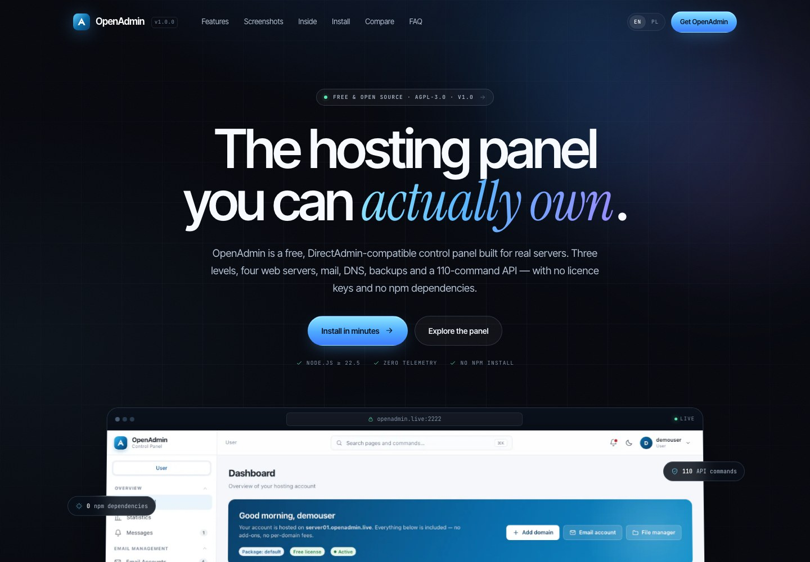
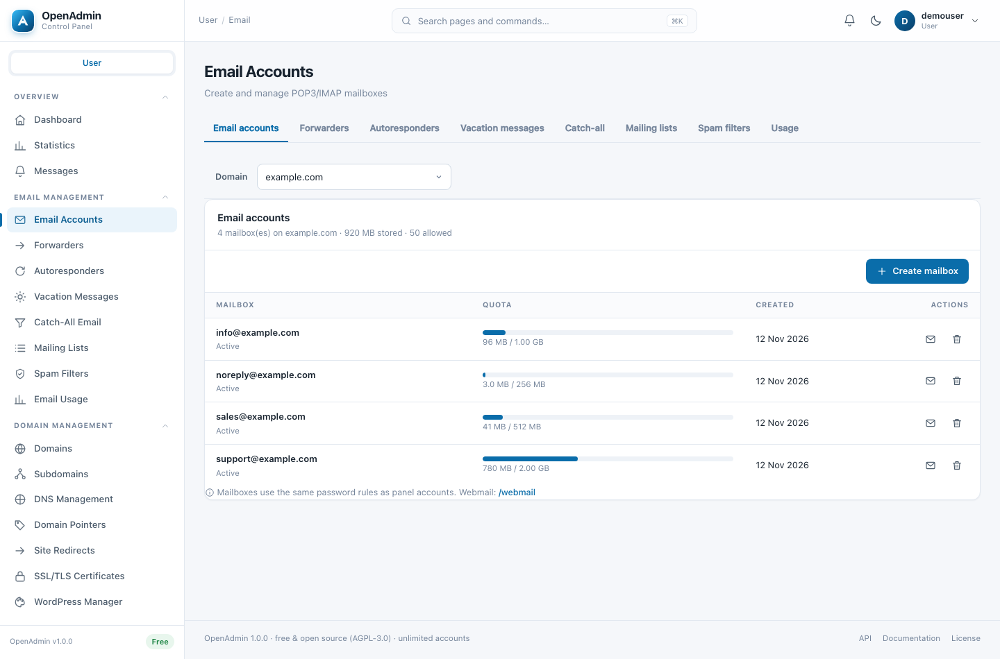
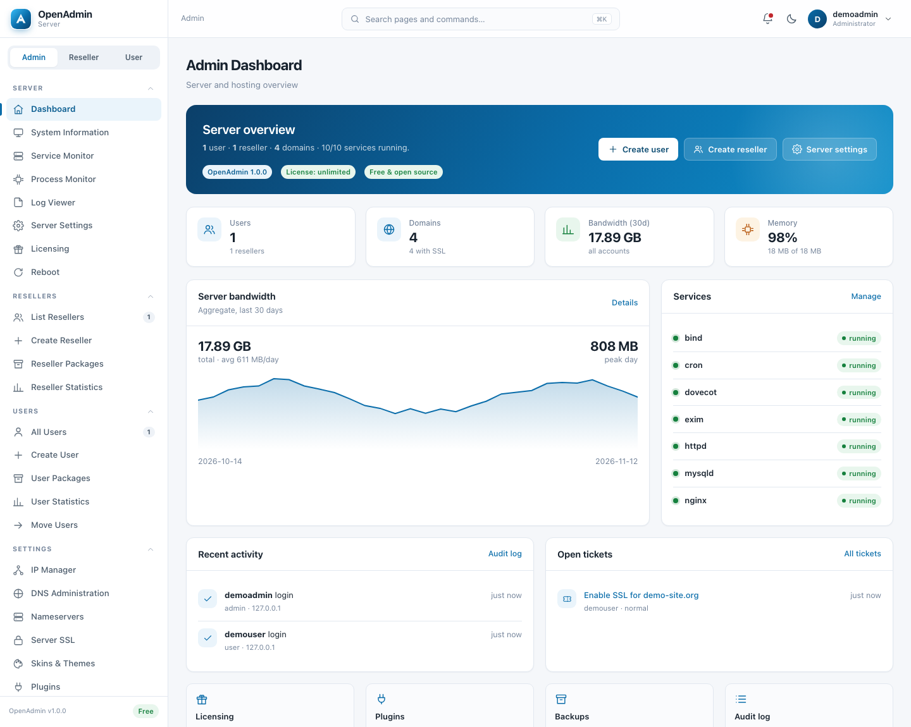
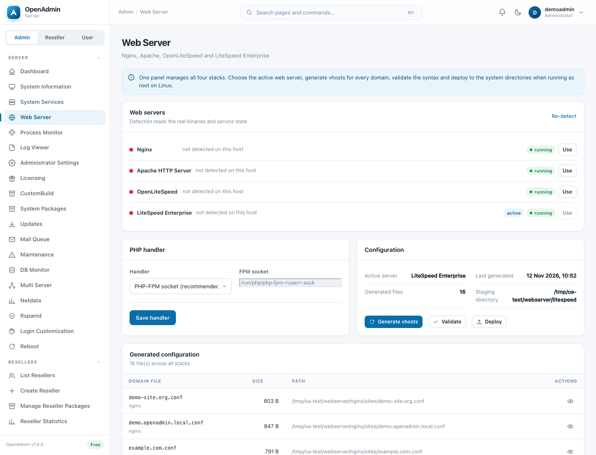
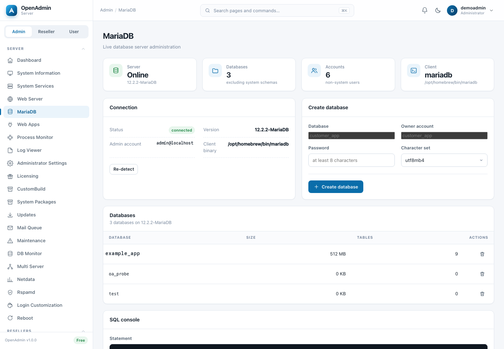
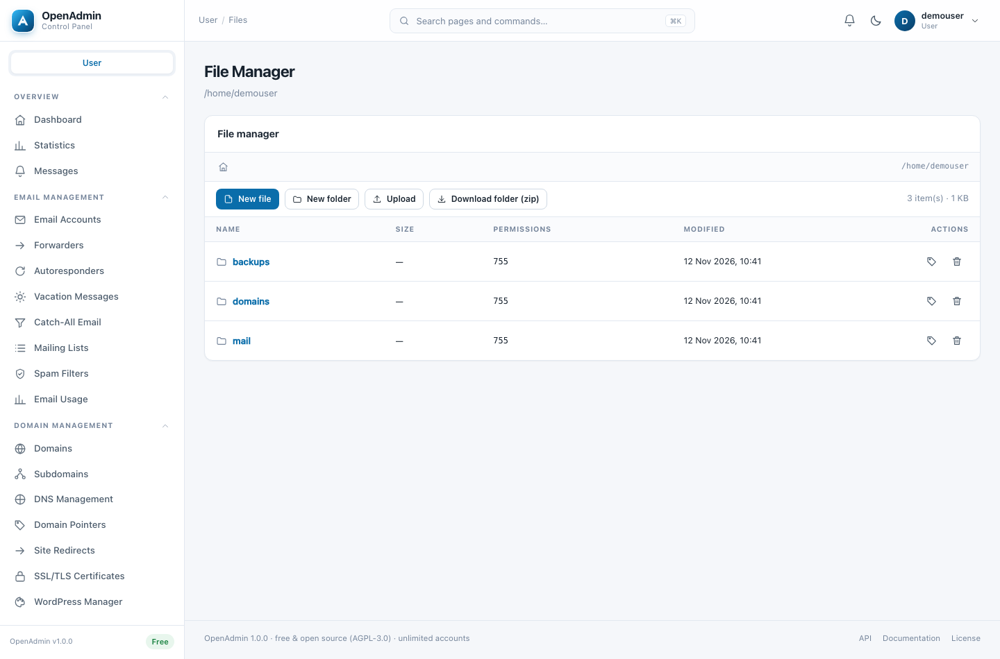
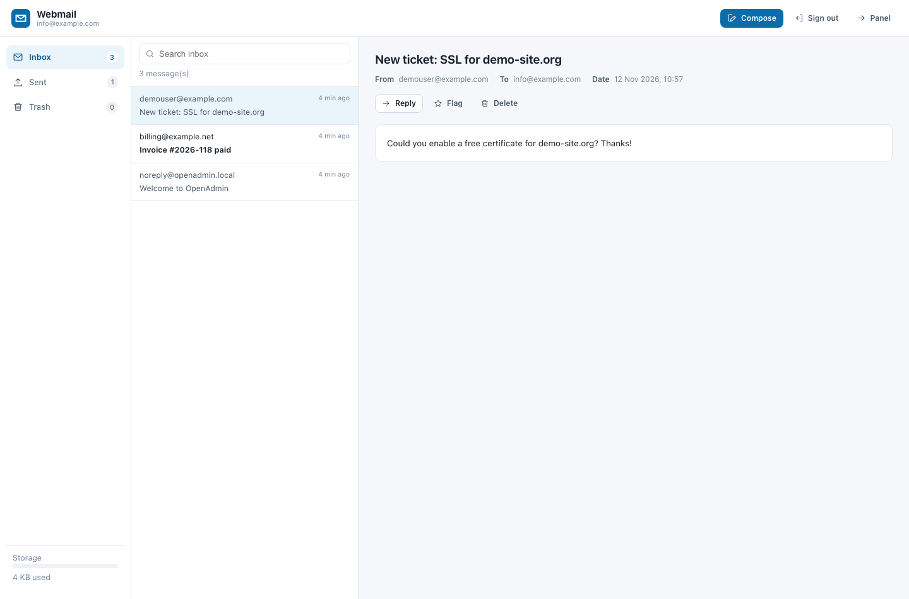
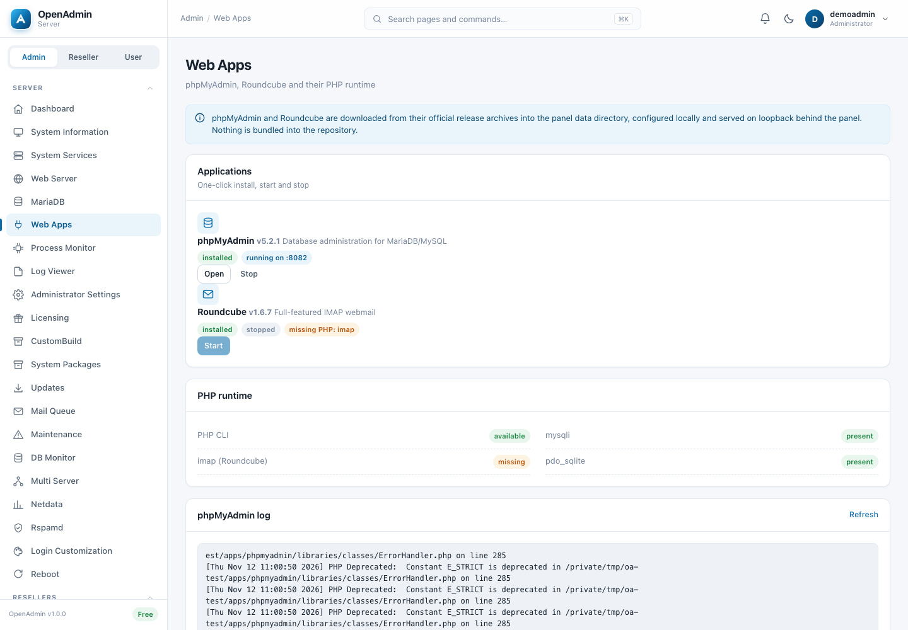
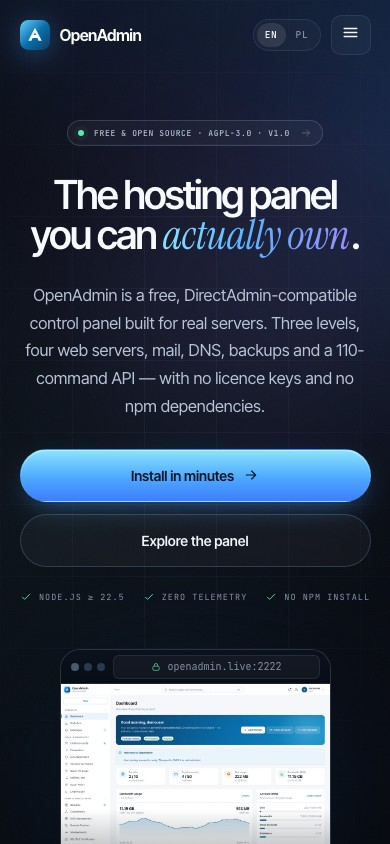

<h1>OpenAdmin</h1>

<strong>The hosting panel you can actually own.</strong>

A free, open-source, DirectAdmin-compatible control panel for real servers. 
Domains, DNS, mail, files, databases, SSL, backups and a 110-command API — with no licence keys and no npm dependencies.

  
  
  
  
  
  

  <a href="https://openadmin.live"><strong>Website</strong></a> ·
  <a href="https://openadmin.live/pl/"><strong>Polski</strong></a> ·
  <a href="https://openadmin.live/openadmin-1.0.0.tar.gz?v=1.0.0"><strong>Download v1.0.0</strong></a> ·
  <a href="https://github.com/JVNECZKO/openadmin"><strong>GitHub</strong></a> ·
  <a href="docs/API.md"><strong>API</strong></a> ·
  <a href="docs/LINUX-DEPLOY.md"><strong>Deploy</strong></a>

  

## Why OpenAdmin

OpenAdmin is a clean-room reimplementation of the DirectAdmin panel experience: the same three
permission levels, the same information architecture and the same <code>CMD_API_*</code> command
surface — rebuilt as readable JavaScript and released under the AGPL-3.0.

It is not a mockup. Every screen writes real system artefacts: BIND zones, Maildirs, web-server
vhosts, crontabs, tar.gz backups, MariaDB databases and TLS certificates.

- **Three panels, one login.** Admin ⊃ Reseller ⊃ User, with package limits enforced in the UI and the API.
- **Four web servers.** Nginx, Apache, OpenLiteSpeed and LiteSpeed Enterprise: detect, generate, validate, deploy.
- **DirectAdmin-compatible.** All 110 published <code>CMD_API_*</code> commands, plus a JSON REST API and OpenAPI 3.
- **Real mail.** Mailboxes, quotas, forwarders, autoresponders, catch-all, webmail, IMAP and MTA delivery.
- **Own everything.** SQLite plus ordinary files. Backups are archives you can open; zones are BIND files.
- **Free forever.** AGPL-3.0, no licence server, no account limits, no telemetry.

## Screenshots

| | |
|---|---|
|  |  |
| User dashboard with live usage, domains and limits | Mailboxes, quotas and the built-in webmail |
|  |  |
| Server overview, services, bandwidth and tickets | Four stacks, generated vhosts and validation |
|  |  |
| Live MariaDB, databases and the SQL console | Jailed file manager with upload and inline editing |
|  |  |
| Webmail that works without external services | phpMyAdmin and Roundcube provisioning |

  

## Quick start

Requires **Node.js 22.5+**. Nothing else — not even <code>npm install</code>.

### Run the demo

    curl -fsSLO 'https://openadmin.live/openadmin-1.0.0.tar.gz?v=1.0.0'
    tar xzf openadmin-1.0.0.tar.gz
    cd openadmin-1.0.0
    OA_DEMO=1 node src/server.mjs

Open <http://127.0.0.1:2222> and sign in:

| Level | Username | Password |
|---|---|---|
| User | <code>demouser</code> | <code>demo</code> |
| Reseller | <code>demoreseller</code> | <code>demo</code> |
| Admin | <code>demoadmin</code> | <code>demo</code> |

The demo runs in the sandbox provider: real files under the data directory, simulated service control.
No root, no database server, no signup.

### Production install

On a fresh Debian 12, Ubuntu 22.04+, Rocky 9 or AlmaLinux 9 server:

    sudo ./install.sh --port 2222

The installer creates the <code>openadmin</code> system user and <code>/var/lib/openadmin</code>, installs
Node.js if needed, writes a hardened systemd unit and prints a generated admin password once. Open port
2222 in your firewall.

Full details: [docs/LINUX-DEPLOY.md](docs/LINUX-DEPLOY.md).

### From a clone

    git clone https://github.com/JVNECZKO/openadmin.git
    cd openadmin
    OA_DEMO=1 node src/server.mjs

### CLI

    node bin/openadmin.mjs install --demo
    node bin/openadmin.mjs doctor
    node bin/openadmin.mjs start
    node bin/openadmin.mjs passwd admin --random

## What is inside

| Area | Included |
|---|---|
| Domains | Add-on domains, subdomains, pointers, redirects, per-domain PHP and SSL |
| DNS | BIND zone editor, validation, deployment, DKIM records |
| Email | Mailboxes, quotas, forwarders, autoresponders, vacation, catch-all, spam filters |
| Webmail | Folders, compose, reply, drafts, attachments, local delivery and MTA queue |
| Files | Jailed file manager, uploads, inline editor, tar.gz download |
| Databases | Live MariaDB databases, users, grants and SQL console; phpMyAdmin |
| Web servers | Nginx, Apache, OpenLiteSpeed, LiteSpeed Enterprise |
| Security | scrypt passwords, TOTP 2FA, CSRF tokens, throttling, audit log |
| Operations | Backups, restore, cron, process monitor, log viewer, health checks |
| Apps | WordPress, Nextcloud, phpMyAdmin, Roundcube, Node.js and Python apps |
| API | 110 <code>CMD_API_*</code> commands, REST <code>/api/v1</code>, OpenAPI 3 |
| Migration | cPanel and DirectAdmin backup import |

## Architecture

    src/
      server.mjs            HTTP server, routing, sessions, CSRF, static assets
      router.mjs            tiny :param router
      config.mjs            env-driven configuration
      db.mjs                node:sqlite schema, migrations, seeding, password hashing
      auth.mjs              login, sessions, capabilities, rate limits, API auth
      core/access.mjs       visibility rules, quotas, counters, usage series
      providers/index.mjs   system boundary: sandbox simulator and Linux/systemd provider
      webserver.mjs         Nginx/Apache/OpenLiteSpeed/LiteSpeed vhost generation
      mariadb.mjs           live MariaDB client
      apps.mjs              phpMyAdmin and Roundcube provisioning
      backups.mjs           tar.gz backups, validation and restore
      dns.mjs               BIND zone rendering, validation and deployment
      cron.mjs              crontab rendering and installation
      mail.mjs              Maildirs, Dovecot passwd-file, Exim maps, deployment
      ssl.mjs               OpenSSL/certbot certificates, PEM validation
      usage.mjs             disk and access-log metering
      ui/                   server-rendered components and pages
      public/               app.css, app.js, favicon.svg, i18n.js

The panel is one Node process, one SQLite file and no build step. Everything privileged goes through
<code>src/providers/index.mjs</code>, so the same product can run against the sandbox provider on a laptop
and the Linux provider on a real server.

## API

### DirectAdmin-compatible

HTTP Basic authentication, URL-encoded responses, <code>error=0</code> convention:

    curl -u demouser:demo http://127.0.0.1:2222/CMD_API_DOMAIN
    # error=0&text=Domains&list%5B%5D=example.com&list%5B%5D=demo-site.org

    curl -u demouser:demo "http://127.0.0.1:2222/CMD_API_POP?action=create&domain=example.com&user=hello&passwd=secret123"
    # error=0&text=Email%20account%20hello%40example.com%20created

### REST

    curl -u demouser:demo http://127.0.0.1:2222/api/v1/me
    curl -u demouser:demo http://127.0.0.1:2222/api/v1/domains
    curl -u demoadmin:demo -X POST http://127.0.0.1:2222/api/v1/users \
      -H "Content-Type: application/json" \
      -d '{"username":"newuser","email":"new@example.com","package":"default","domain":"new.example.com"}'

The OpenAPI 3 document is served at <code>/api/v1/openapi.json</code>. See [docs/API.md](docs/API.md).

## Security

- Passwords: <code>scrypt</code> with a per-password salt and constant-time comparison.
- Sessions: 256-bit tokens, HttpOnly + SameSite=Lax cookies, server-side expiry and revocation.
- CSRF: synchroniser tokens on every state-changing form, plus <code>X-CSRF-Token</code> for JSON.
- Login throttling: 8 failures per IP/username per 10 minutes, feeding the brute-force monitor.
- Headers: CSP, <code>nosniff</code>, <code>SAMEORIGIN</code>, Referrer-Policy, Permissions-Policy.
- Authorisation: every query is scoped by level; mutations are gated per user and domain.
- File manager: canonicalised paths jailed to the account home.
- Audit log: actor, level, action, target, IP and timestamp for privileged operations.
- Telemetry: none. No licence server and no phone-home.

To report a vulnerability, please use GitHub private vulnerability reporting as described in
[SECURITY.md](SECURITY.md).

## Advanced operations

The second phase adds the operational depth audited from Webuzo:

- **Security Center** — nftables IP blocks, SSH hardening, root keys, password
  policy, country blocks, compiler/wheel groups, fork-bomb limits, SMTP egress,
  ModSecurity policy.
- **Mail Operations Center** — address diagnosis, Exim queue, delivery events,
  RBL/sender filters, routing, remote SMTP.
- **Backup Center** — local/SFTP/FTP/S3 destinations, scheduled jobs, retention,
  dry-run and real restore.
- **Plans & limits** — feature sets, resource limits, per-user systemd cgroups
  for PHP-FPM when CPU/memory limits are set.
- **PHP / Web Stack** — MultiPHP, INI, extensions, FPM tuning, Apache modules.
- **DNS Operations** — zone TTL, MX, templates, cleanup.
- **Live transfer** — cPanel/DirectAdmin SSH+rsync batch transfer.
- **Update Center**, **API keys + MCP**, **notification channels**, **reseller
  privilege plans**, **support access**, **AutoSSL**, **log center**, **process
  actions**, **storage destinations**, **panel branding/ACL** and **WebDisk**.
- **Application catalogue** — one visual catalogue with WordPress, Nextcloud,
  Joomla, Drupal, PrestaShop and Moodle; native installers for WP/Nextcloud and
  web installers where the project has no CLI. Resellers can install apps for a
  customer domain.
- **PostgreSQL**, **multi-server registry**, **demo accounts**, **shell/skeleton**.

See [docs/PLATFORM-FEATURES.md](docs/PLATFORM-FEATURES.md) for prerequisites and
explicit limitations (GeoIP, IO quotas, remote transfer DBs, translations).

## Compatibility

OpenAdmin is an independent implementation. It shares the <code>CMD_API_*</code> names, parameters and
response shape, the panel names and the <code>/home/&lt;user&gt;/domains/…</code> conventions — not code,
binaries, templates, icons or other assets. It is not a drop-in binary replacement for DirectAdmin.

See [docs/COMPATIBILITY.md](docs/COMPATIBILITY.md) for the command matrix.

## Documentation

- [API](docs/API.md) — endpoints and response examples
- [Compatibility](docs/COMPATIBILITY.md) — DirectAdmin command matrix
- [Linux deployment](docs/LINUX-DEPLOY.md) — Nginx, Apache, OpenLiteSpeed, BIND, Exim, Dovecot
- [Migration import](docs/IMPORT.md) — cPanel and DirectAdmin archives
- [Webuzo audit](docs/WEBUZO-AUDIT.md) — feature gaps and QoL roadmap (read-only production audit)
- [Platform features](docs/PLATFORM-FEATURES.md) — Security Center, Mail Ops, backups, limits, MCP, WebDisk
- [CRUD audit](docs/CRUD-AUDIT.md) — resource-by-resource completeness and fixed gaps
- [User & reseller parity](docs/USER-RESELLER-PARITY.md) — full end-user toolbox, reseller domains/apps, visual app catalogue
- [Roundcube](docs/ROUNDCUBE.md) — mail client setup
- [Frontend reconstruction](docs/recon.md) — how the compatibility surface was recovered
- [Landing page source](site/README.md) — build and deploy the marketing site

## Contributing

Bug reports, compatibility notes and pull requests are welcome. The project has no runtime
dependencies; the test suite is plain <code>node --test</code>.

    node --test tests/*.test.mjs

The suite is **305/305 passing** locally and on the Debian container (Node 22,
no npm dependencies).

Please read [CONTRIBUTING.md](CONTRIBUTING.md) before opening a pull request.

## License

OpenAdmin is released under the **GNU Affero General Public License v3.0 or later**.
See [LICENSE](LICENSE).

OpenAdmin is an independent project and is not affiliated with DirectAdmin or cPanel.
DirectAdmin and cPanel are trademarks of their respective owners.

### Build identification

Generate the immutable deployment descriptor before packaging and copy it next
to `package.json` in the installed tree. The runtime reads this file first.

    node tools/build-info.mjs
    scp build-info.json root@host:/usr/local/openadmin/build-info.json
